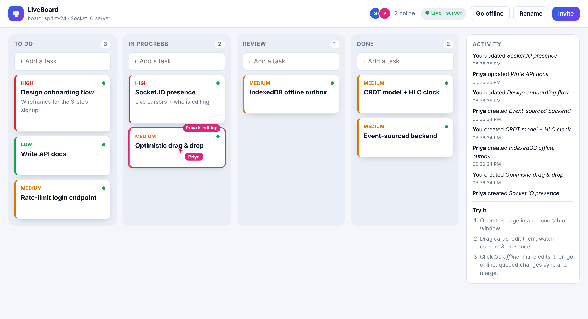
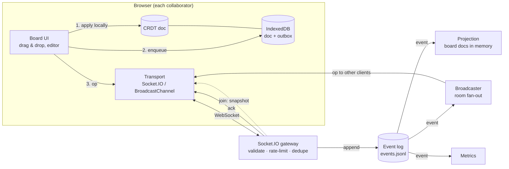

# LiveBoard — real-time collaborative task board

A Trello-style Kanban board where several people edit the same board at once: **live cursors, presence, "who is editing", instant sync over WebSockets, optimistic UI, offline-first storage in IndexedDB, and conflict-free merging with a CRDT**. The backend is an **event-sourced Node.js service** built on Express and Socket.IO.

**Live demo:** [sahulhameed-developer.github.io/liveboard](https://sahulhameed-developer.github.io/liveboard/) — open it in **two tabs** to collaborate. GitHub Pages is static, so the demo syncs tabs with `BroadcastChannel`; run the server (below) for real multi-user sync over Socket.IO.



## Highlights

| Area | What it does |
|---|---|
| **Real-time** | Socket.IO rooms per board; ops are acked to the sender and broadcast to everyone else. Cursor positions are sent as *volatile* messages (~25/s, dropped under load, never queued). |
| **Presence** | Avatars of who is online, live named cursors, and an "X is editing" badge on the card someone has open. |
| **Conflict resolution** | A **CRDT**: a last-writer-wins map of card fields, ordered by a **hybrid logical clock (HLC)**. Ops are commutative and idempotent, so every client converges to the same board in any delivery order. |
| **Optimistic UI** | Changes apply locally at once and show an amber "syncing" dot until the server acks; rejected ops are dropped and the client resyncs. |
| **Offline-first** | The board and an **outbox of un-acked ops** live in **IndexedDB**. The board renders from IndexedDB before the network connects; offline edits queue up and replay on reconnect. Replays are safe because the server de-duplicates op ids. |
| **Event-driven backend** | Every accepted op is appended to an **event log** (JSON Lines) and emitted as an event; independent subscribers build the in-memory projection, broadcast to the room and track metrics. On restart the log is replayed. |
| **Ordering** | Fractional indexing: moving a card writes only that card's `order`, never re-numbers the column. |
| **Hardening** | Schema validation of every op, per-socket token-bucket rate limiting, clamped cursor coordinates, board-id whitelist. |

## Architecture



**Write path:** the client applies the op to its CRDT doc (UI updates instantly) → stores it in the IndexedDB outbox → sends it → the server validates it and appends it to the event log → subscribers update the projection and fan out to the room → the server acks → the client removes the op from the outbox.

**Reconnect path:** `join` returns the board snapshot → the client CRDT-merges it with local state → the client replays its outbox. Duplicate ops are acked without being re-applied.

## Benchmark

`node bench/load.js` opens real Socket.IO connections and measures the time from a writer sending an op to every other client receiving it.

| Setup | Result |
|---|---|
| 1,000 concurrent WebSocket clients across 20 boards (50 per board), 1,000 ops | **49,000 / 49,000 deliveries (100%)** |
| Fan-out latency (send → received by others) | **p50 8.7 ms · p95 19.5 ms · p99 28.5 ms** |
| Ack latency (send → server ack) | p50 9.2 ms · p95 20.1 ms |
| Throughput | ~22,000 message deliveries / s |

*Measured on a 2-vCPU Linux container with Node 22, with the server **and** all 1,000 clients in the same machine (so they compete for CPU), over loopback. Network latency in a real deployment comes on top. Reproduce with `CLIENTS=1000 BOARDS=20 OPS=50 node bench/load.js`.*

## Run locally

```bash
git clone https://github.com/SahulHameed-developer/liveboard.git
cd liveboard
npm install
cp .env.example .env      # optional
npm start                 # http://localhost:3000/?board=my-team
npm test                  # 13 tests: CRDT properties + Socket.IO integration
node bench/load.js        # load test
```

Open the URL in two browsers (or a normal and a private window) to see two collaborators. Use `?board=<name>` for separate boards and `?mode=local` to force the tab-to-tab demo mode.

### Environment variables

| Name | Default | Purpose |
|---|---|---|
| `PORT` | `3000` | HTTP + WebSocket port |
| `DATA_FILE` | `./data/events.jsonl` | Append-only event log, replayed into memory on startup |

### API

| Interface | Name | Payload |
|---|---|---|
| Socket.IO | `join` | `{ board, user:{id,name,color} }` → ack `{ ok, doc, seq, users }` |
| Socket.IO | `op` | `{ id, card, fields, ts, by }` → ack `{ ok, seq }` / `{ ok:false, error, retry? }` |
| Socket.IO | `cursor`, `focus` | `{ x, y }` (0–1) · `cardId \| null` |
| Server → client | `op`, `cursor`, `presence:join`, `presence:leave`, `presence:focus` | |
| HTTP | `GET /api/health` | `{ status, seq, boards, events, connections }` |
| HTTP | `GET /api/boards/:board` | materialised board view |

## Design decisions & trade-offs

- **CRDT vs. operational transformation (OT).** OT needs a central server to transform concurrent ops and is hard to get right offline. The board's data is a set of independent fields (title, column, order, priority), so a per-field LWW-map CRDT is simple and works offline. The cost: two people editing the *same field* at the same time keep the later edit instead of merging both. That's fine for card fields, but a collaborative *text* editor would need a sequence CRDT (e.g. Yjs/RGA).
- **Hybrid logical clock vs. wall-clock timestamps.** Wall clocks drift between devices, so a device with a fast clock could always "win". The HLC keeps timestamps close to real time but guarantees that anything a client has *seen* is ordered before what it writes next (see the clock-skew test).
- **Event log vs. a database.** An append-only JSON Lines log is the simplest form of event sourcing. It gives replay, an audit trail and easy projections with zero infrastructure. Trade-off: startup replays the whole log. The next steps are periodic snapshots, then Postgres or Redis Streams.
- **Socket.IO vs. raw WebSockets / WebRTC.** Socket.IO adds rooms, acks, reconnection and volatile messages. Peer-to-peer WebRTC would remove the server hop for cursors but complicates NAT traversal and still needs a server for persistence.
- **Single process.** All state for a board lives in one Node process. To scale out you'd add the Socket.IO Redis adapter and route each board to a shard. The event-driven design keeps the projection and broadcaster independent, so they can move to separate workers.

## Project structure

```
public/   crdt.js (shared with server) · app.js (UI) · transport.js · store.js (IndexedDB) · index.html · styles.css
src/      app.js (Express + Socket.IO) · eventStore.js · server.js
test/     crdt.test.js · server.test.js
bench/    load.js
```

## Author

**A Mohamed Sahul Hameed** — Senior Full Stack Developer · [Portfolio](https://sahulhameed-developer.github.io/portfolio/) · [LinkedIn](https://www.linkedin.com/in/mohamed-sahul-hameed-372262117/)

MIT licensed.
